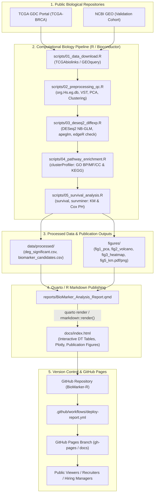

# Architecture & Deployment Diagram (`architecture_diagram.md`)

This document details the end-to-end execution workflow and provides step-by-step instructions for running the pipeline locally, compiling the interactive report, and publishing it freely to **GitHub Pages** with zero cloud hosting dependencies.

---

## 1. End-to-End Pipeline & Publishing Workflow



---

## 2. Step-by-Step Instructions: Local Run to GitHub Pages Deployment

### Step A: Initialize the Reproducible Environment
1. Clone the repository:
   ```bash
   git clone https://github.com/<your-username>/BioMarker-R.git
   cd BioMarker-R
   ```
2. Restore package dependencies in R:
   ```R
   # Inside an R terminal or RStudio
   renv::restore()
   ```

---

### Step B: Run the Complete Bioinformatics Pipeline
Execute the master pipeline script, which runs all sequential modules from data download to biomarker triangulation:
```bash
Rscript scripts/run_pipeline.R
```
Or use the Makefile:
```bash
make all
```
**Outputs generated**:
- Clean tables saved in `data/processed/` (`deg_significant.csv`, `pathway_enrichment_results.csv`, `candidate_biomarkers.csv`).
- High-resolution publication plots saved in `figures/` (PDF and 300 DPI PNG).

---

### Step C: Compile the Interactive Report
Render the comprehensive Quarto / R Markdown report into a standalone, searchable HTML page located in `docs/`:
```bash
quarto render reports/BioMarker_Analysis_Report.qmd --output-dir ../docs --output index.html
```
Or via R console:
```R
rmarkdown::render("reports/BioMarker_Analysis_Report.Rmd", output_dir = "docs", output_file = "index.html")
```
*Tip*: Open `docs/index.html` in your local browser to inspect the interactive tables and figures before publishing.

---

### Step D: Publish Automatically on GitHub Pages

1. **Commit and Push to GitHub**:
   ```bash
   git add .
   git commit -m "feat: complete reproducible transcriptomics pipeline and report"
   git push origin main
   ```
2. **Enable GitHub Pages**:
   - Go to your repository on GitHub: `https://github.com/<your-username>/BioMarker-R`.
   - Click **Settings** $\rightarrow$ **Pages** (in the left sidebar).
   - Under **Build and deployment** $\rightarrow$ **Source**:
     - Choose **Deploy from a branch**.
     - **Branch**: Select `main`, folder: `/docs`.
     - Click **Save**.
     *(Alternatively, use the included GitHub Actions workflow `.github/workflows/deploy-report.yml` to build and deploy automatically).*
3. **Verify the Live Deployment**:
   - Within 1–2 minutes, your report will be live at:
     `https://<your-username>.github.io/BioMarker-R/`
   - Test that interactive tables (search, sort, pagination) and hover tooltips work seamlessly without any hosting costs or backend maintenance.
